## Bandit level 0-1

### SSH 
 Dengan menggunakan SSH yaitu jaringan untuk mengontrol perangkat lain dengan jarak jauh dengan aman.Dengan menghubungkan *bandit.labs.overthewire.org, on port 2220*  username dan password *bandit0*.
 **password:** 6y2kwnwK6grgvwvpvLaa2T1cpFEKOhNR

 ## Bandit level 1-2

 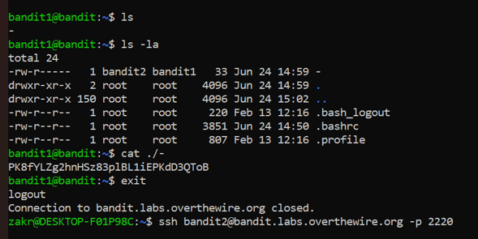

 ### ls
 untuk menampilkan apa saja yang ada di dalam file atau pun folder yang ada.
 ### ls -la
 untuk menampilkan file file yang yang tersembunyi di dalam folder.
 Dan kemudian keluar dari *bandit1@bandit* dengan menggunakan *exit*
 ## cat ./-
 Digunakan untuk membedah atau membuka isi file, **tanda titik** tersebut digunakan menandai sebagai kita sekarang berada di sini dan **tanda garis miring** sebagai pemisah atau pembatas.**Tanda strip** Yaitu tanda yang setelah garis miring biasanya untuk diberikan nama folder atau file yang ingin dibedah isinya dan didalam **Bandit level 1-2** nama folder memiliki *tanda strip*.
 **password :** PK8fYLZg2hnHSz83plBL1iEPKdD3QToB

 ## Bandit level 2-3
 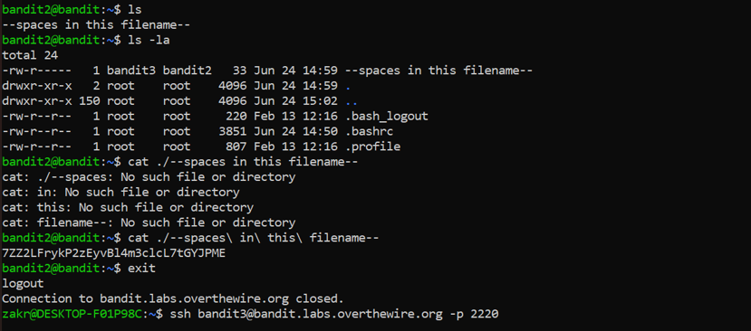
 Di dalam Bandit Level 2-3 diketahui untuk memanggil file --spaces in this filename-- dengan menggunakan *ls* dan menggunakan **ls -la** untuk menampilkan semua file file tersembunyi yang ada.

 cat ./ = untuk membedah file **--spaces\ in\ this\ filename--** 

Dan didalam bandit level ini membedah file dengan memberikan **garis miring** di setiap kata nama file karena sistem tidak tau kalau file tersebut hanya 1 file. Oleh karena itu, diberikan *tanda garis miring* disetiap kata bahwasanya, file itu hanya 1. kalau tidak, sistem mengira memiliki *4 file*. **Password:** 7ZZ2LFrykP2zEyvBl4m3clcL7tGYJPME

## Bandit level 3-4
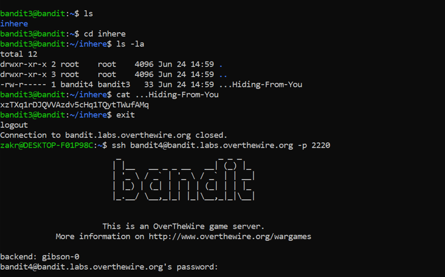

Dalam bandit level 3-4 perintahnya yaitu untuk mencari file tersembunyi dalam **inhere** dengan memasukkan *cd*
### cd
untuk code yang digunakan untuk berpindah kedalam file. "cd inhere" berarti masuk kedalam folder inhere.
dan kita mencari yang sekira nya mencurigakan yaitu dengan dengan tulisan **...hiding from-you**
**Password :** xzTXq1rDJQVVAzdv5cHq1TQytTWufAMq

## Bandit level 4-5
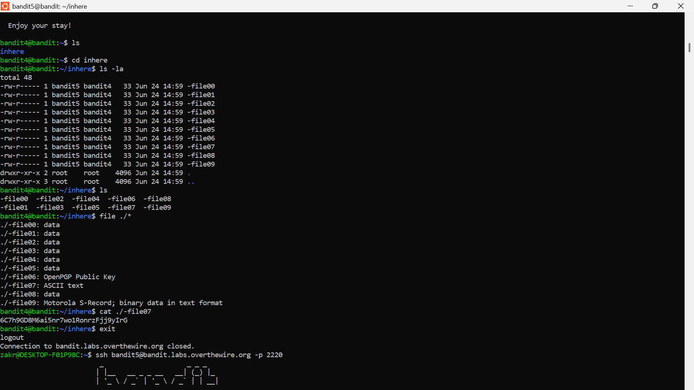

Dalam bandit level 4-5 perintah untuk mencari password disalah satu file file yang ada. Dan di dalam nya memiliki 9 file. saya menggunakan code **file** .
### file 
alat yang digunakan untuk mencari tau jenis file.
Dan di level ini kita di perintah untuk mencari password di salah satu di file tersebut, membutuhkan waktu yang lama untuk mencari satu persatu. Oleh karena itu, menggunakan **file ./***.

### *
Tanda ini digunakan untuk menampilkan semua jenis file file yang ada.
**Password :** 6C7h9GD8M6ai5nr7wo1RonrzFjj9yIrG
## Bandit level 5-6

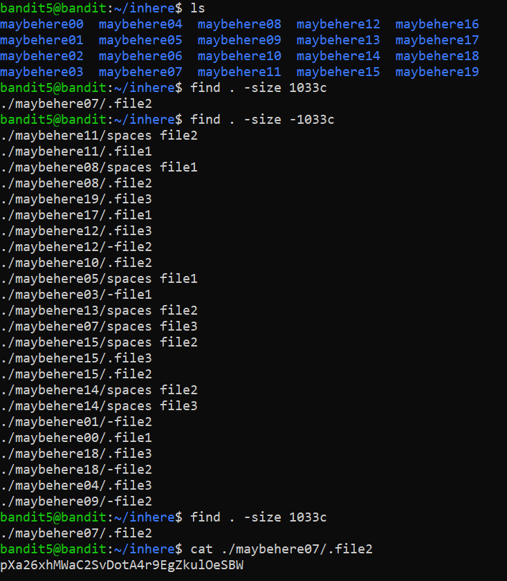
Bandit level 5-6 yang menggunakan code **find**.
### find
untuk mencari lokasi atau letak file itu berada dimana.
Dan dilevel ini diketahui dengan *size* **1033 byte** dengan code **c**.
Dapat mencari file dengan ukuran 1033 byte
Yang terletak di  **maybehere07**membedah file tersebut dengan code *cat* 
**Password :** pXa26xhMWaC2SvDotA4r9EgZkulOeSBW

## Bandit level 6-7
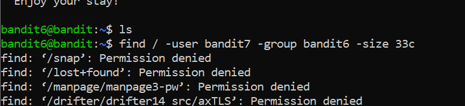
Di bandit level ini menggunakan code **find** 
yang diketahui user bandit7 dan group bandit6 dengan ukuran 33 byte dengan code **C**

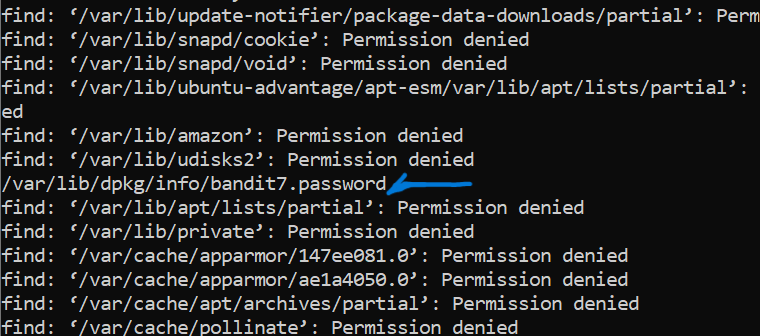
Dan akan muncul berbagai file yang ada, cari yang paling berbeda dari yang lain atau agak menjanggal.

**Password :** Bmnnvf82KzQlfxgAI2d1zYbr1u9pr3E3

## Bandit level 7-8 
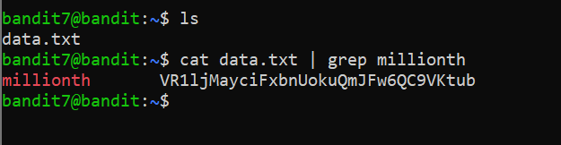
Di bandit level 7-8 perintah untuk melakukan pencarian password di dalam file yang bernama *millonth* dan tidak bisa untuk mencarinya satu satu untuk mencarinya. Oleh karena itu, menggunakan code **grep**
### grep
Alat untuk mencari file file dengan kata file *millionth*.
Ibaratkan mencari suatu code didalam ratusan halaman dengan kata *millonth*
**Password :** VR1ljMayciFxbnUokuQmJFw6QC9VKtub

## Bandit level 8-9
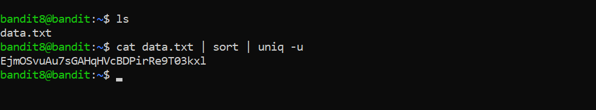
Di bandit level 8-9 untuk mencari salah satu dari sekian banyak nya file dengan menggunakan code **sort** dan **uniq -u**.
### sort
alat yang biasanya di gunakan untuk mengurutkan file file berdasarkan abjad file.
### uniq -u
alat ini membuang file file yang doble atau ledih dari 2, dan alat ini sebagai penyaring dan mengambil salah satunya.
**Password :** EjmOSvuAu7sGAHqHVcBDPirRe9T03kxl

## Bandit level 9-10
Di bandit level 9-10 
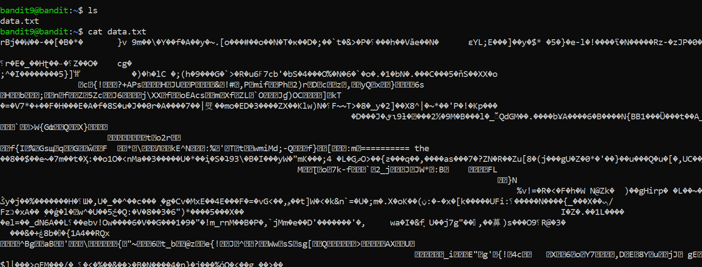
Ketika di level ini akan di munculkan oleh code code yang tidak bisa dibaca oleh manusia. oleh karena itu, menggunakan code **strings**.

### strings
alat ini digunakan untuk memudahkan untuk bisa dibaca oleh manusia.

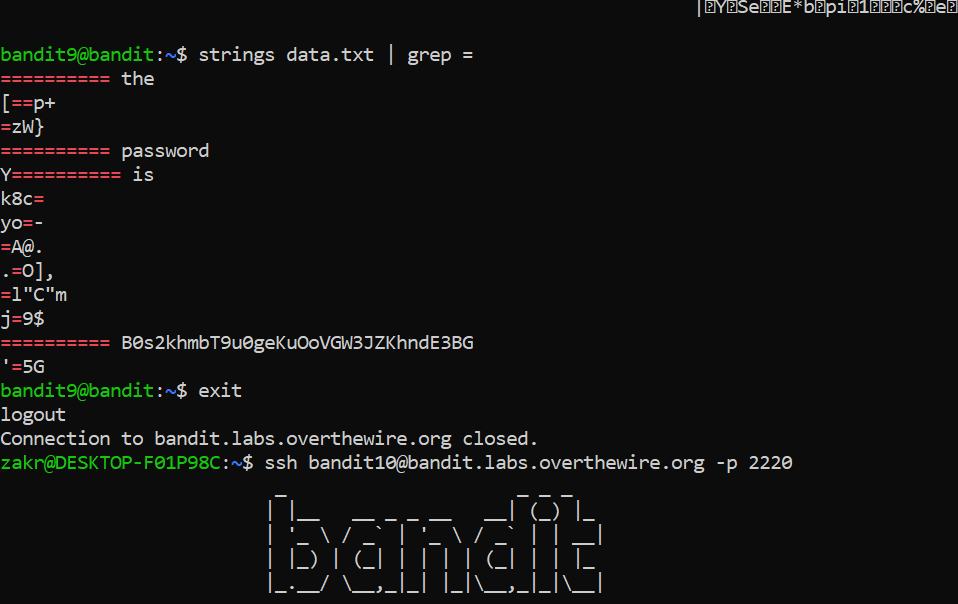
Dengan digabungkan dengan code **grep** untuk mencari file dengan tanda =. 
dengan ini kita dapat memudahkan untuk dibaca
**Password :** B0s2khmbT9u0geKuOoVGW3JZKhndE3BG

## Bandit level 10-11
Di bandit level 10-11 
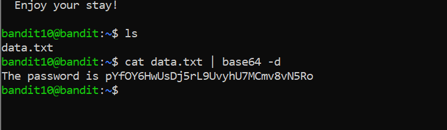

### Base64
alat untuk mengubah (encode) **base64 -n** ,dan alat untuk mengetahui code rahasia (decode) **base64 -d**.
**Password :** pYfOY6HwUsDj5rL9UvyhU7MCmv8vN5Ro

## Bandit level 11-12
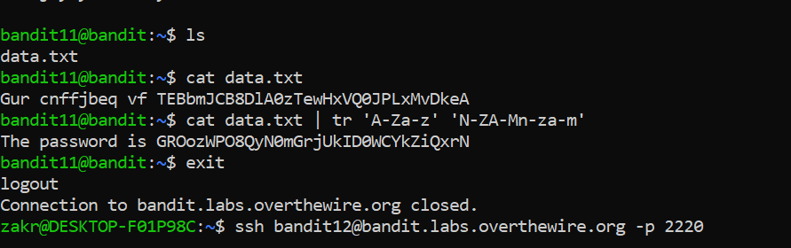
Di bandit level 11-12 diketahui bahwa jika terdapat A-Z dan a-z , dengan jumlah huruf 13 dari huruf N-Z dan kembali lagi A-M kecil dan besar 
Pada code **tr**.
**Password**: GROozWPO8QyN0mGrjUkID0WCYkZiQxrN

## Bandit level 12-13
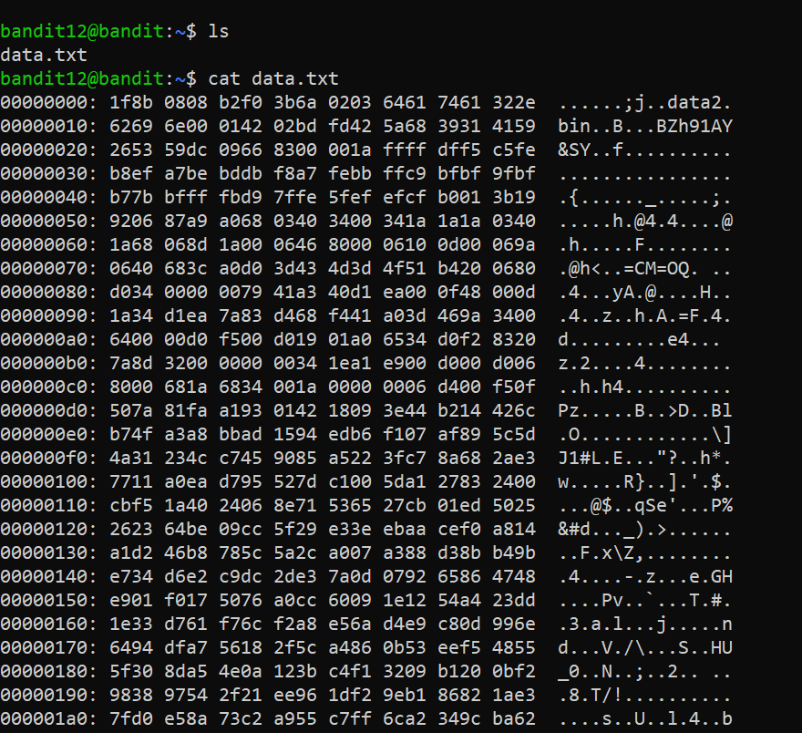
Disini dimunculkan dengan hexadesimal dan harus mengopres nya lagi 
level ini juga memiliki file file yang berlapis lapis 

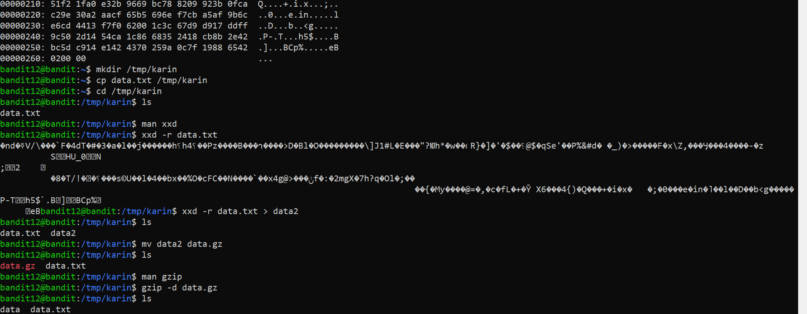

### mkdir
alat untuk membuat folder sementara untuk menyalin data.txt kedalam folder sementara tersebut agar kita dapat mengakses nya

### cp 
code untuk menyalin data.txt kedalam folder sementara yang sudah dibuat tadi. 

Dan masuk kedalam folder semantara tersebut yang sudah dibuat tadi menggunakan code **cd**.

### xxd -r
alat yang digunakan untuk merudah dari hexadesimal ke biner ataupun sebaliknya di file data.txt di folder sementara.

### mv 
alat untuk memindahkan file data menjadi file **gzip** dengan memindahkan file data ke **data.gz**. dan mengecek nya dengan code **ls** apakah sudah pindah atau belum.

### gzip -d
alat untuk mengopres atau membuka file dan harus menggunakan **.gz** kalau tidak akan terjadi error.olehkarena itu harus memindahkan ke file .gz \ gzip.dan dapat mengecek menggunakan code **ls** untu mengetahui bahwa data.gz sudah masuk.
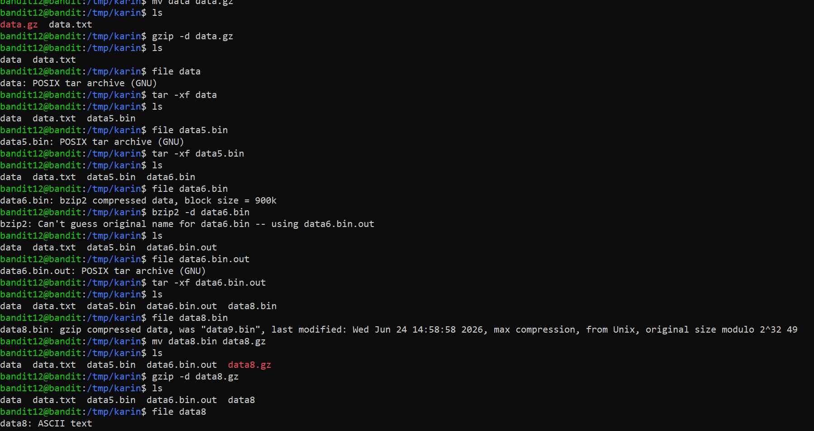

### tar -xf
alat untuk mengopres atau membuka file yang memiliki format seperti **.tar .txt .pdf**
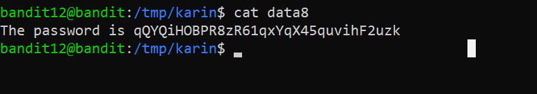
Dan membedah file tersebut dengan menggunakan code **cat**

**Password**: qQYQiHOBPR8zR61qxYqX45quvihF2uzk

## Bandit level 13-14
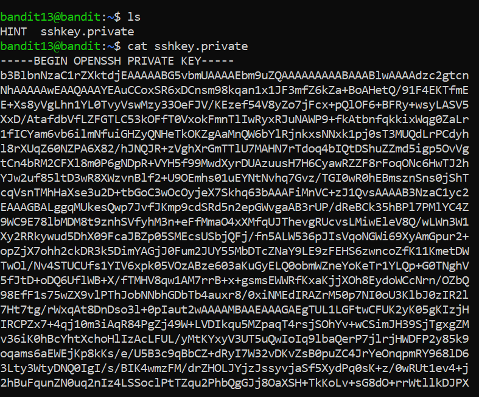

disini akan dimunculkan dengan yang namanya kunci privat SSH

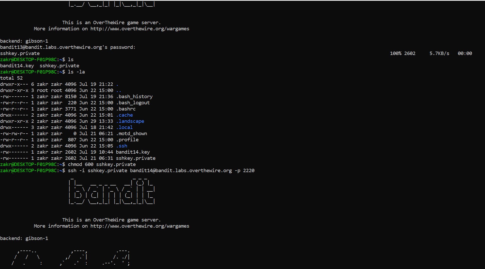
### nano
alat ini untuk menyimpan dan direktori milik kita. untuk menyimpan kunci private SSH yang 
telah disimpan di direktori kita sendiri 
menggunakan code **cp**.
### cp
alat untuk copy paste suatu data dan disimpan di direktori kita sendiri

### chmod 600
(change mode) alat untuk mengganti mode :
baca = 4

tulis = 2

menjalankan = 1

Nilainya dijumlahkan :

Digit ke-1 (6)  4 + 2 = 6

Digit ke-2 (0) = 0

Digit ke-3 (0) = 0

### ssh -i
dengan mengganti pengaturan menggunakan **chmod** kita menggunakan **-i** untuk mencari kunci privat di lokasi standar 

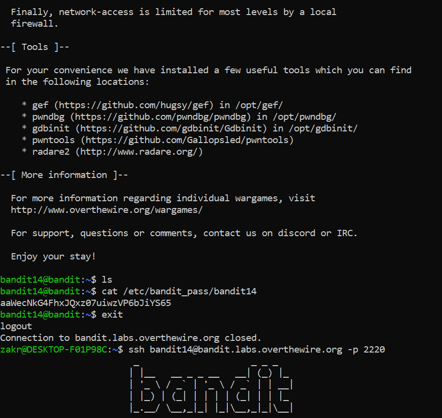
disini akan membedah file yang sudah diketahui 

**Password**: aaWecNkG4FhxJQxz07uiwzVP6bJiYS65

## Bandit level 14-15
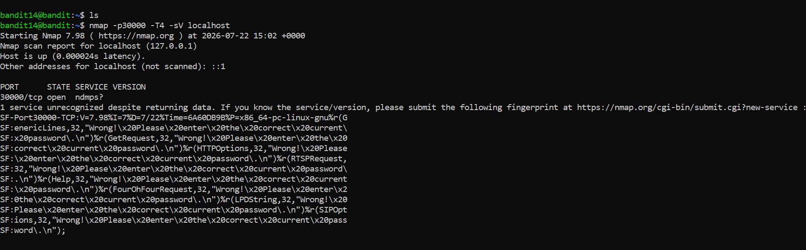

### nmap 
alat ini untuk mencari port yang terbuka pada port 30000

### -p30000 
Tanda **-p** ini menandakan port dengan nomer port 30000 

### -sV 
pada perintah **nmap** digunakan untuk mendeteksi port jadi tidak hanya untuk membuka port

### -T4 
alat untuk mengatur seberapa cepat kita untuk mengecek. Dan memiliki 5 jenis :

- -T0 : Sangat lambat 
- -T1 : lambat dan tersembunyi
- -T2 : Memperlambat scan agar tdk membebani jaringan
- -T3 : (Normal) Tingkatan bawaan nmap
- -T4 : cepat, standar yang umum
- -T5 : sangat cepat tapi, memiliki resiko dengan kehilangan data atau error
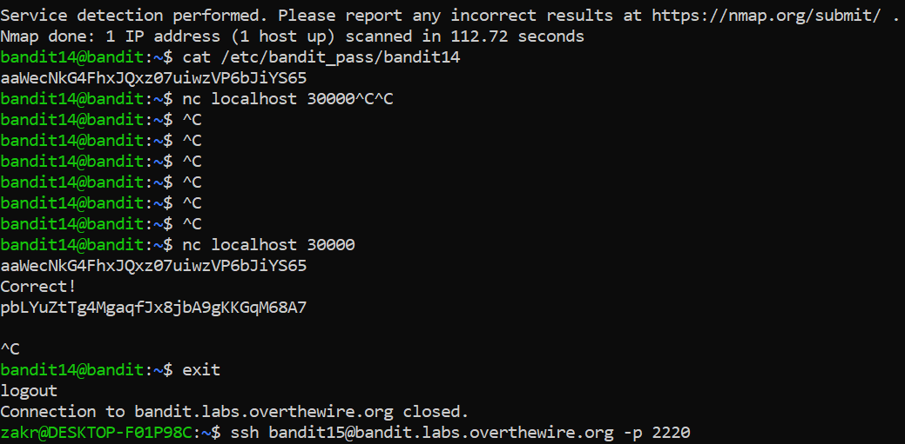
### nc
alat yang dipakai untuk menghubungkan port lokal, mengirim kata sandi, atau membuka port server

**Password**: pbLYuZtTg4MgaqfJx8jbA9gKKGqM68A7 
## Bandit level 15-16
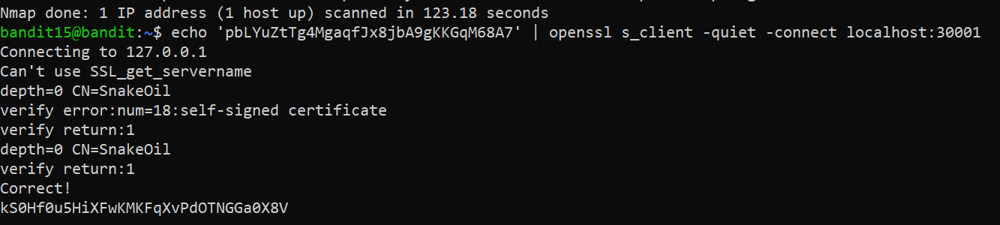

### echo
untuk mencetak teks ke layar dan digunakan bersama tanda pipa  | untuk mengirim teks atau password ke perintah lain atau server local

### openssl s_client
alat yang dilakukan untuk menghubungkan ke server lokal 

**Password**: kS0Hf0u5HiXFwKMKFqXvPdOTNGGa0X8V
## Bandit level 16-17

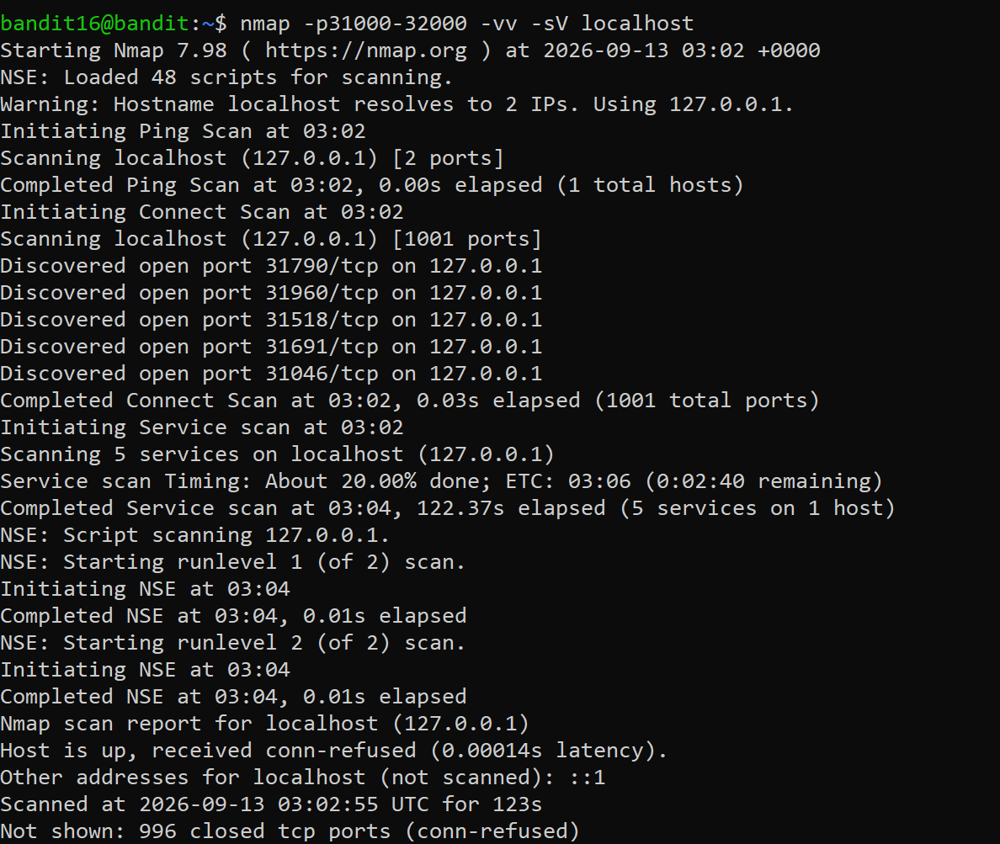
### -vv
memaksa Nmap lebih akurat untuk mencari port yang terbuka

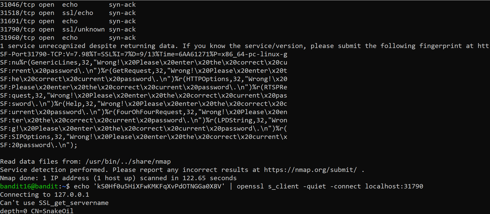
### echo
Mencetak file atau teks tanpa menulisnya ulang lagi

### openssl s_client
membuka SSL/TLS 
## Kunci private ssh
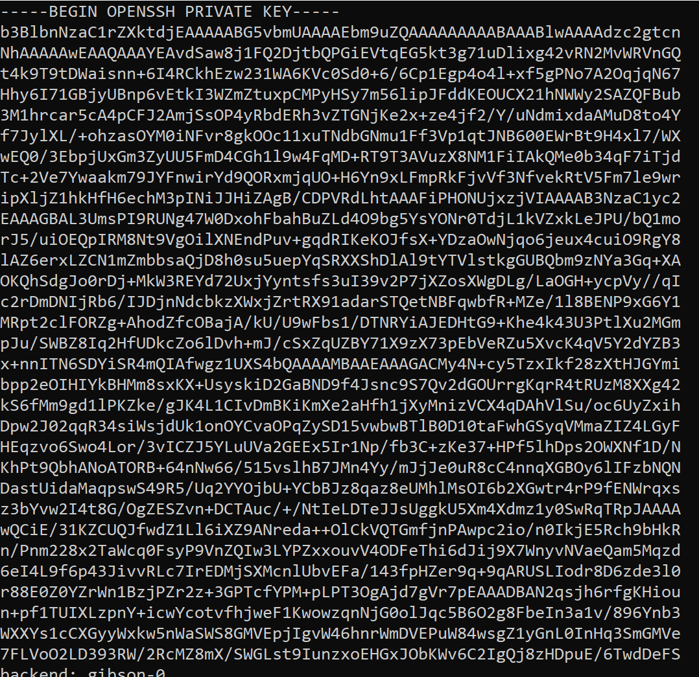

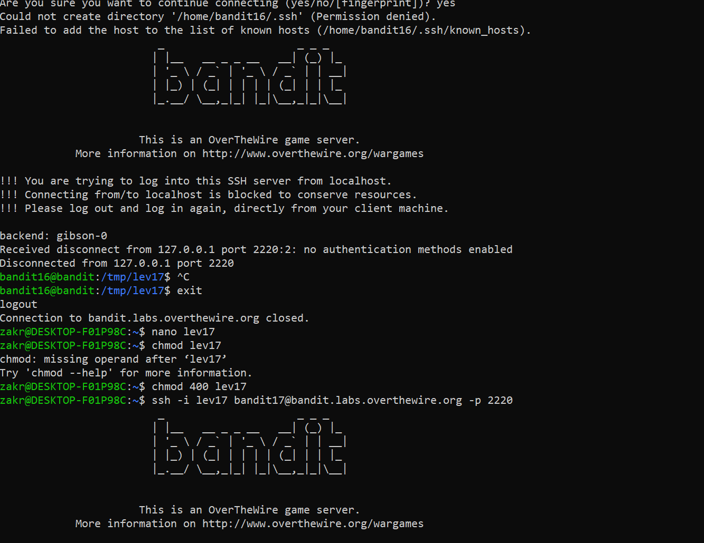
**Password**: pWXMAZoxGC8JmDMfmT5MGEsobMM3vnj2 
## Bandit level 17-18

Di level 17-18 diperintahkan untuk membandingkan antara password baru dan password lama
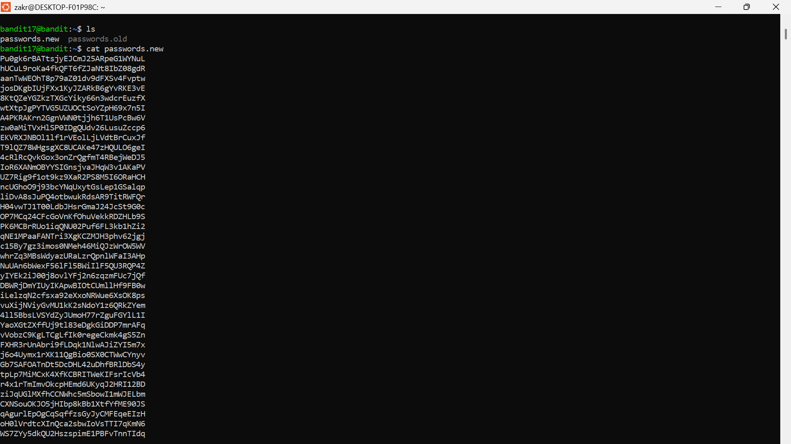
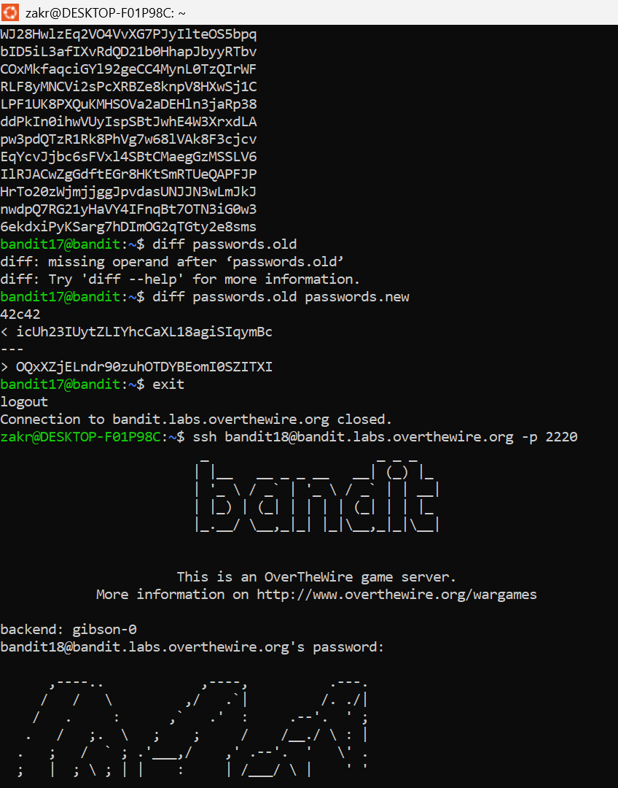

### diff
alat untuk membandingkan antara 2 file atau 2 password yang hampir sama persis

              
**Password**: OQxXZjELndr90zuhOTDYBEomI0SZITXI
## Bandit level 18-19
Di level 18-19 diketahui bahwa telah dimodif .bashrc dan secara otomatis keluar ketika memasukkan SSH

### Penulisan
ssh bandit18@bandit.labs.overthewire.org -p 2220 cat readme
karena kalau tidak memakai cat readme maka langsung keluar otomatis

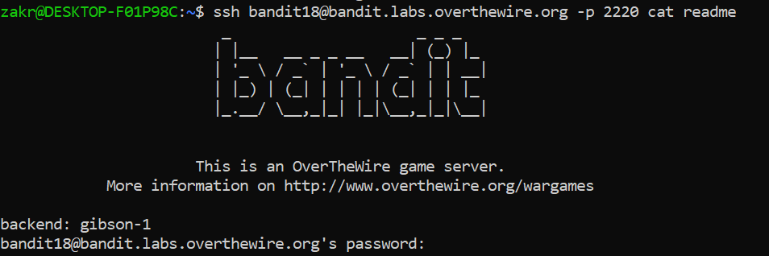
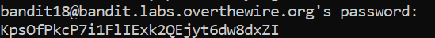
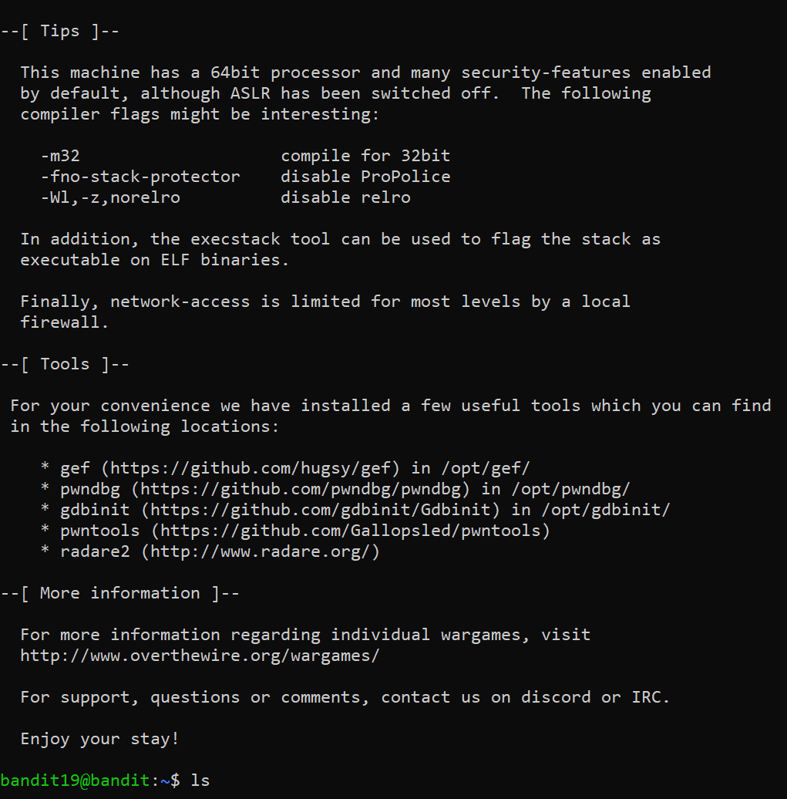

**Password**: KpsOfPkcP7i1FlIExk2QEjyt6dw8dxZI

## Bandit level 19-20
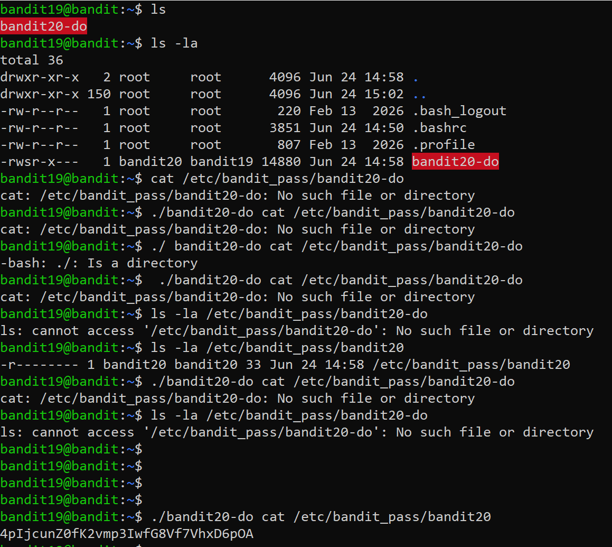
### ./bandit20-do
menjalankan file yang dieksekusi, ./ tanda bahwa terletak pada directory saat ini

**Password**: 4pIjcunZ0fK2vmp3IwfG8Vf7VhxD6pOA
## Bandit level 20-21
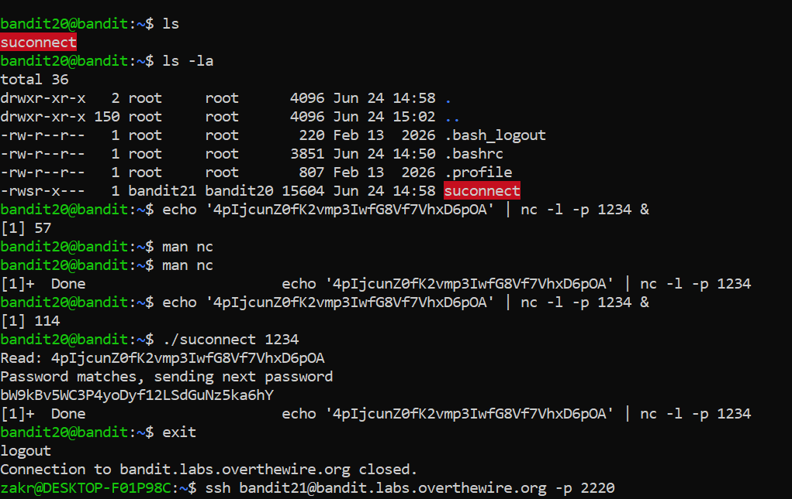

**Password**: bW9kBv5WC3P4yoDyf12LSdGuNz5ka6hY

